# WarmPlayer

**A skeuomorphic vinyl turntable + cassette deck for your local music library.**
One tiny Python server, two self-contained HTML pages. No framework, no build step, no CDN.

English | [简体中文](README.zh-CN.md)

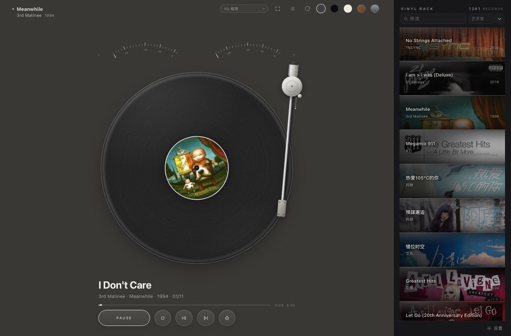

---

## What it is

WarmPlayer turns the music folders on your Mac (or any machine running Python) into a warm, tactile listening room:

- **Vinyl page** — a rotating record with tonearm, 33⅓ RPM label, and a full sleeve you can pull out, flip and read the spine.
- **Tape page** — an aiwa-style auto-reverse cassette deck. Tapes come in two skins (paper sticker / direct print), reels wind with real remaining-tape thickness, and Dolby albums get the classic double-D badge.
- Both pages share one header, one library and one audio engine — switching tabs never moves the chrome.

It is built to run **as a home server**: keep it running on a Mac mini, then listen from your iPad, phone, car browser or anything on your LAN / tailnet / port-forward.

## Features

### Vinyl turntable
Spinning record, moving tonearm, live VU needles or a 21-band spectrum, sleeve preview with cover-tinted back and a readable spine.

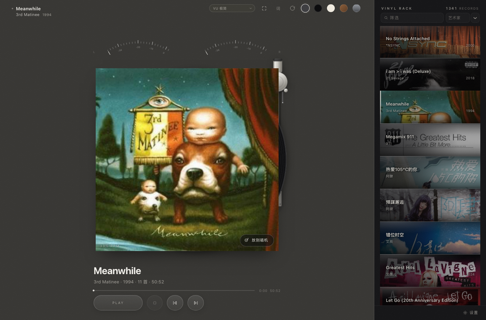

### Colored & picture vinyl
One switch turns the disc into translucent colored resin pulled from the cover's own colors, grooves and all. A second switch prints the full cover onto the disc — a picture disc — while keeping the groove texture on top.

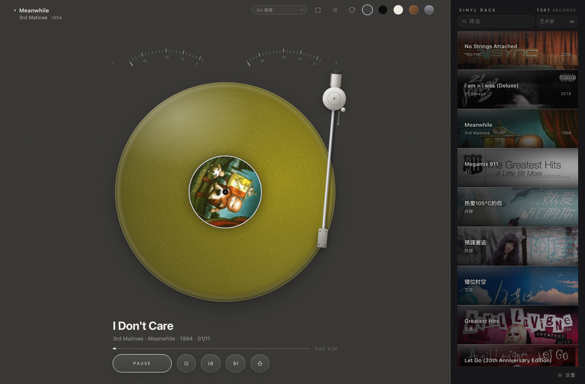

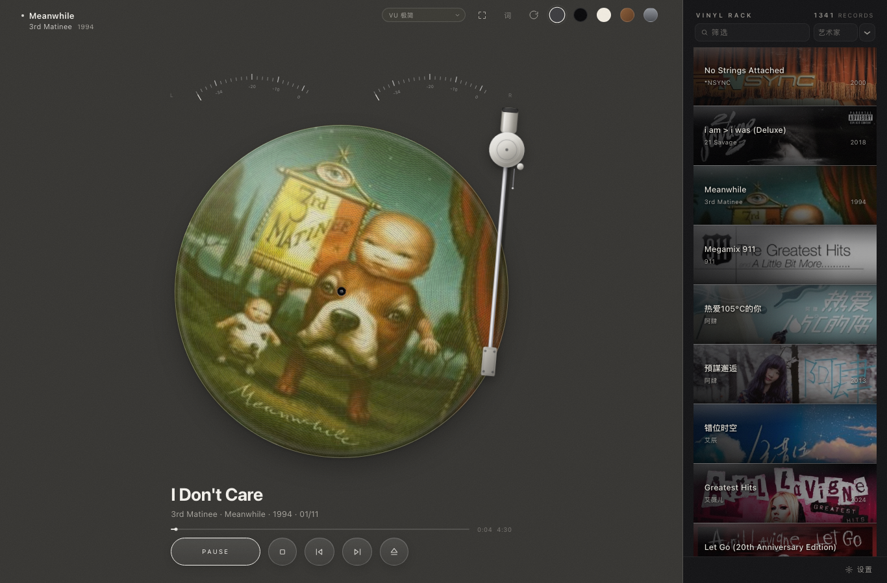

### Blurred-cover background
On solid-color themes the cover can be blurred and stretched into the page background, so the whole room takes the album's color.

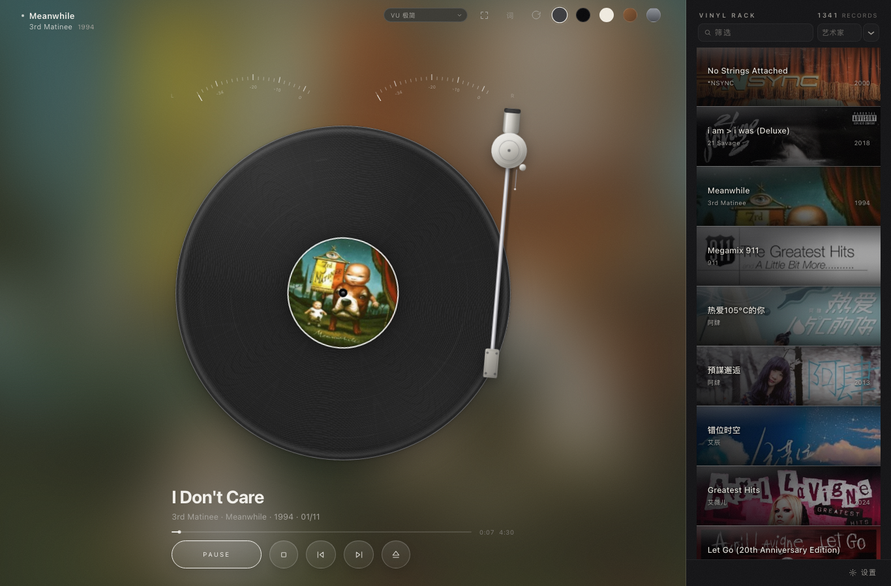

### Cassette deck — sticker skin
Paper label wrapped over the reels, SIDE A/B box, STEREO mark, cover-derived title band. The window shows the actual tape pack: thick on the left at the start of a side, thinning as it plays.

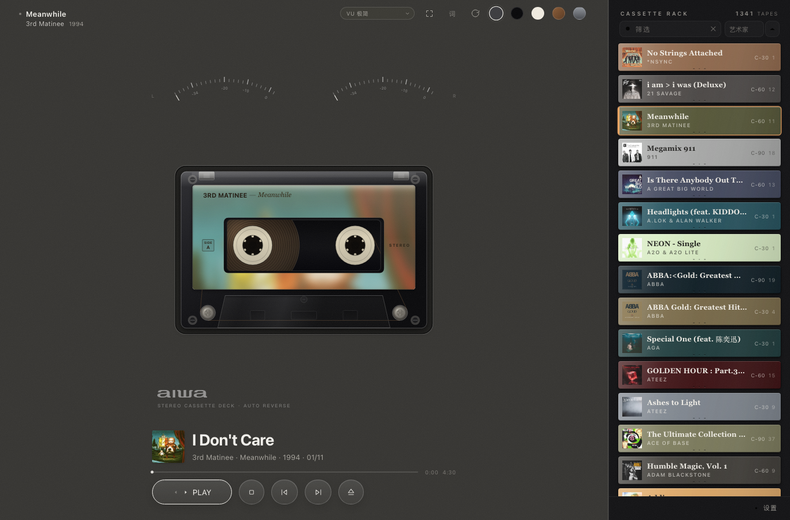

### Cassette deck — direct-print skin
Ink printed straight onto a translucent colored shell, same layout as the sticker, no label background.

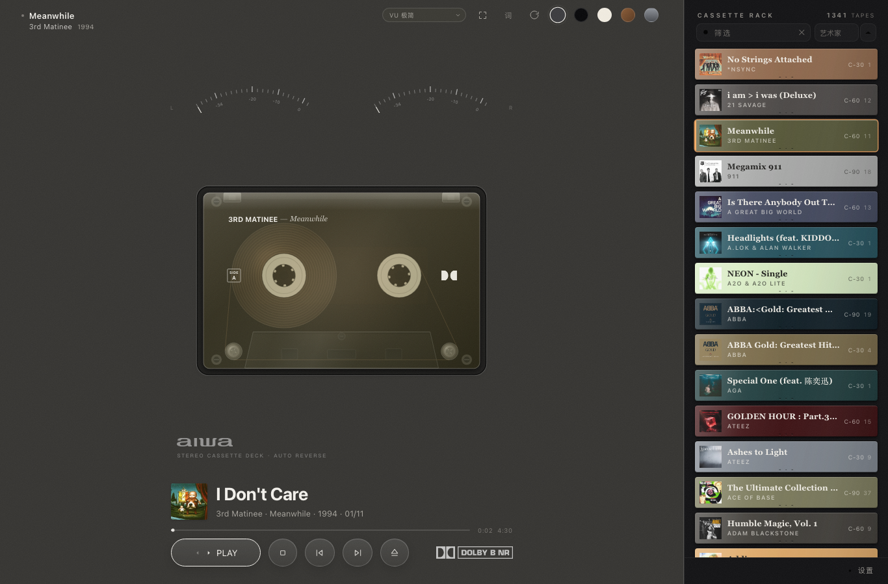

### Dolby badge
Albums tagged as Dolby (Atmos / EAC-3 / AC-4 …) light up the hollow double-D mark in the right gap of the label — ink-colored, no white fill, no background plate.

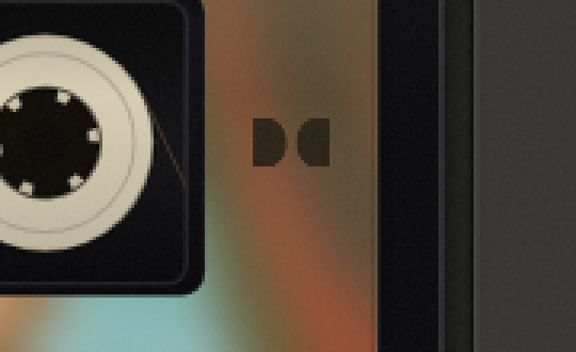

### Cassette rack library
Your whole library as a wall of tapes: cover thumbnail, album, artist, C-60/C-90 length computed from real duration, filter box and artist/title sort. The vinyl page gets the same rack with record sleeves.

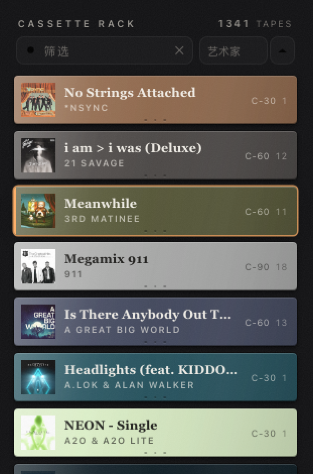

### Sleeve & spine preview
Eject a tape and its case stands up: front cover, tinted back, and a spine you can actually read (bottom-to-top, CJK and Latin aligned).

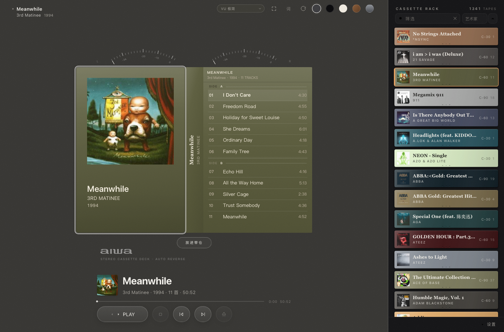

### Phone & tablet ready
The deck panel grows a little on narrow screens so the aiwa logo and the "STEREO CASSETTE DECK · AUTO REVERSE" line never get clipped.

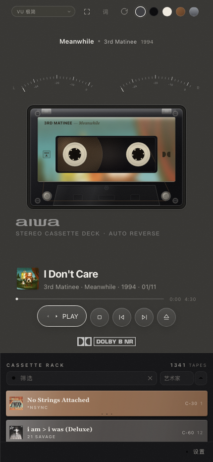

### Server-side spectrum & smart audio
- The spectrum is computed **on the server** (ffmpeg + numpy) and streamed to the page — meters keep dancing even for formats the browser cannot decode.
- Safari plays ALAC natively; other browsers get on-demand transcoding (cached).
- Dolby codecs are detected per track; optional 5.1 → stereo downmix.

### Built to stay alive
- **Never sleeps while serving** — a permanent guard blocks system sleep, but lets the display turn off when nothing is playing.
- **Display stays awake only during playback** (any client, 30 s heartbeat), then releases.
- Self-watchdog restarts the server if it stops answering; orphan guards are reaped on boot.
- Ships with a launchd recipe for start-at-login + auto-restart.

### Themes & meters
Five panel themes — graphite ink, pure black, paper, walnut wood, brushed metal — shared by both pages, plus switchable meter styles (spectrum / VU, minimal variants) and a lyrics toggle.

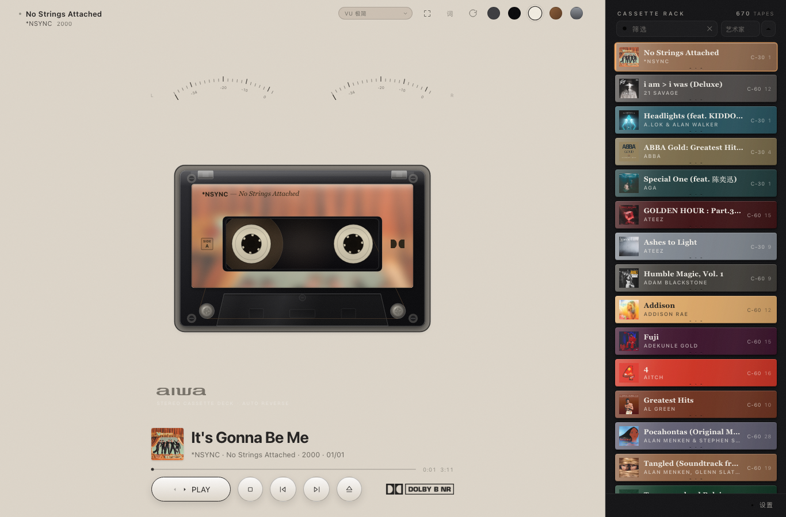

## Quick start

Requirements: macOS or Linux, Python 3.9+, `numpy` (for the spectrum), `ffmpeg` on PATH (for transcoding / Dolby / spectrum of non-native formats). The sleep guards are macOS-only and are skipped elsewhere.

```bash
git clone https://github.com/aiventian-dev/warmplayer.git
cd warmplayer
python3 vinyl_server.py            # serves on 0.0.0.0:8900
```

Open:

- Vinyl: `http://localhost:8900/`
- Tape:  `http://localhost:8900/tape`
- From other devices: `http://<your-mac-ip>:8900/`

On first run, open **设置 / Settings** (bottom of the rack) and add your music folders. The library scans in the background — pages are usable immediately.

On macOS you can also double-click `启动唱片机.command`.

### Configuration

| File | Purpose |
|---|---|
| `folders.json` | Your music folders (created by the UI; see `folders.example.json`) |
| `settings.json` | Transcoding default, Dolby mode, remote folder password (see `settings.example.json`) |
| `cache/` | Tags, covers, tints, transcodes — all generated, safe to delete |

> **Security note:** the server has no TLS and no accounts. The `folder_pwd` password only protects the folder-management UI from remote clients. Keep it on your LAN / VPN, or put it behind an HTTPS reverse proxy. Change the default password before exposing it.

### Run as a login service (macOS)

See [`docs/launchd.md`](docs/launchd.md) for a `launchd` plist that starts WarmPlayer at login and restarts it if it dies.

### Run on Synology / any Docker host

See [`docs/deploy-synology.md`](docs/deploy-synology.md): container pins python + ffmpeg + numpy, survives DSM upgrades, restarts on boot; music volumes mount read-only, DSM reverse proxy adds HTTPS.

## Architecture

```
vinyl_server.py     Python stdlib HTTP server (ThreadingHTTPServer)
                    library scan · tags · covers · tint extraction
                    ffmpeg transcode cache · server-side spectrum stream
                    awake guards · self-watchdog
唱片机.html          Vinyl page — one self-contained file (HTML+CSS+JS+assets)
磁带机.html          Tape page — same base, cassette layer on top
```

No database, no node_modules. The pages talk to `/api/*` endpoints on the same origin.

## Roadmap ideas

- Playlist / queue UI
- More deck skins
- Optional authentication for the whole UI

## License

[MIT](LICENSE)

## Credits

Built with care for physical media that never wore out. Album art in screenshots belongs to its respective owners and is shown for demonstration only.
