# WarmPlayer 暖播放器

**把你本地的音乐库，变成一台黑胶唱片机 + 一台磁带卡座。**
一个小巧的 Python 服务端，两个完全自包含的 HTML 页面。无框架、无构建、无 CDN。

[English](README.md) | 简体中文

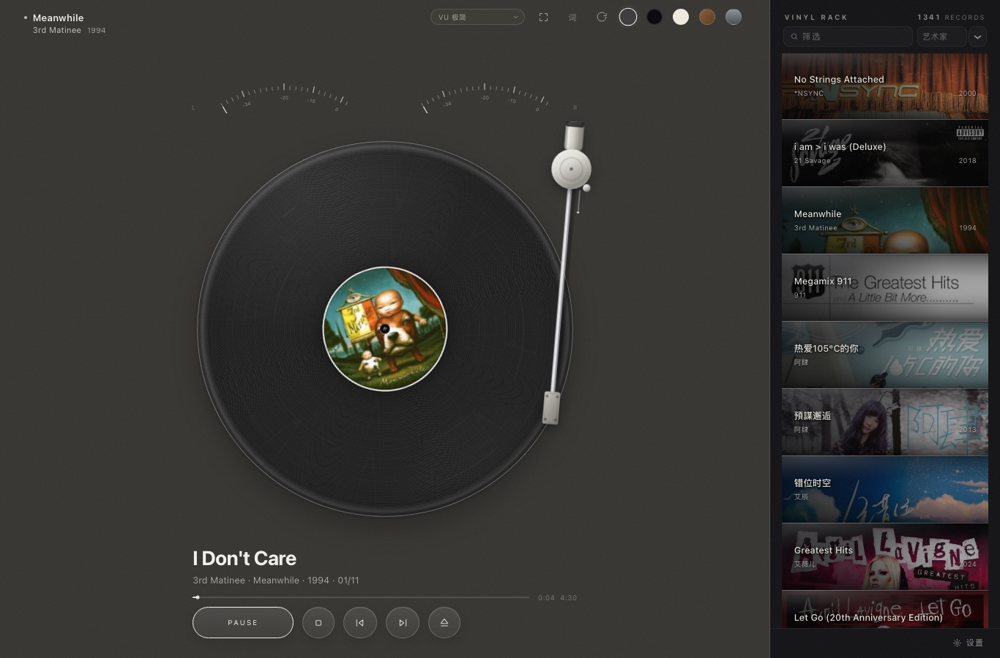

---

## 它是什么

WarmPlayer 把你 Mac（或任何能跑 Python 的机器）上的音乐文件夹，变成一间有温度的听音室：

- **唱片机页** —— 旋转的唱片、移动的唱臂、33⅓ RPM 标，封套可以抽出来翻面，书脊上的字真的能读。
- **磁带机页** —— aiwa 风格的自动翻面卡座。磁带有两种皮肤（纸贴纸 / 直印彩壳），卷带厚度随播放真实变化，杜比专辑会点亮经典的双 D 标。
- 两页共用同一个表头、同一个曲库、同一套音频引擎——切 tab 时界面纹丝不动。

它天生就是**当家庭服务器用的**：让它常驻在 Mac mini 上，然后用 iPad、手机、车机浏览器，或局域网 / 内网穿透 / 端口映射后的任何设备来听。

## 特性

### 黑胶唱片机
旋转唱片、唱臂起落、实时 VU 指针或 21 段频谱；封套预览带封面取色的封底和可读的书脊。

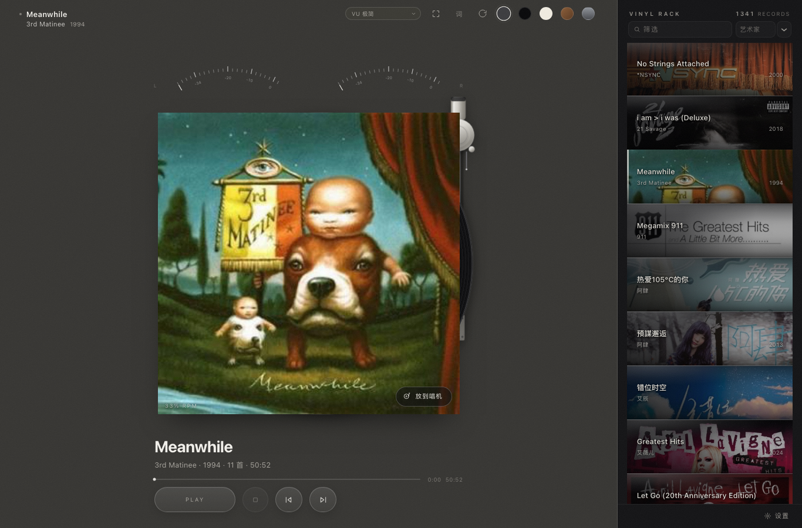

### 彩胶与图案胶
一个开关把盘体换成封面取色的半透明彩色树脂，密纹保留；再一个开关把整张封面印上盘面——图案胶——纹路仍压在图案之上。

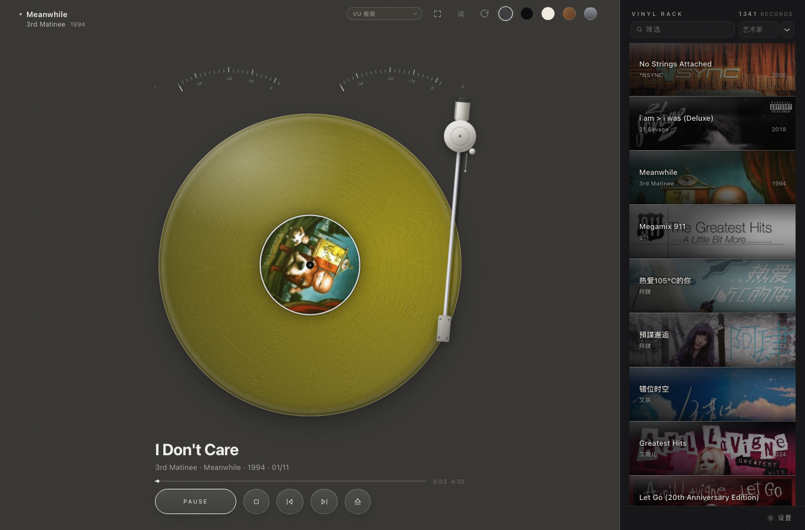

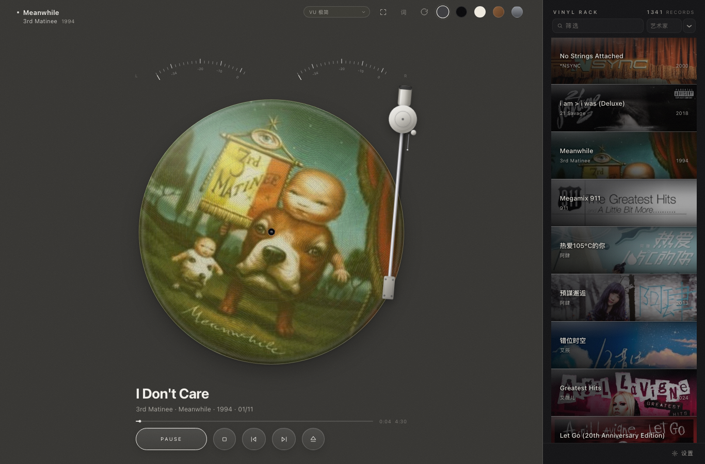

### 模糊封面背景
纯色主题下，可以把封面虚化铺满整个页面背景，让整间听音室染上这张专辑的颜色。

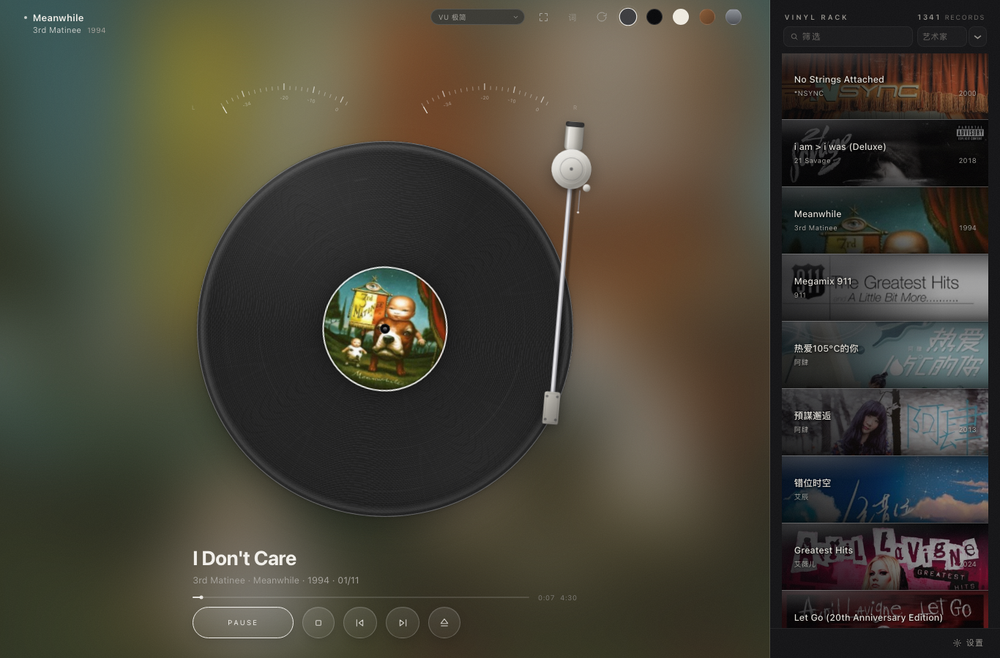

### 磁带卡座 · 贴纸皮肤
纸标签盖住磁带卷，SIDE A/B 方框、STEREO 标、封面取色的标题带。开窗里是真实的带卷：一面刚开始时左卷厚，播着播着就变薄。

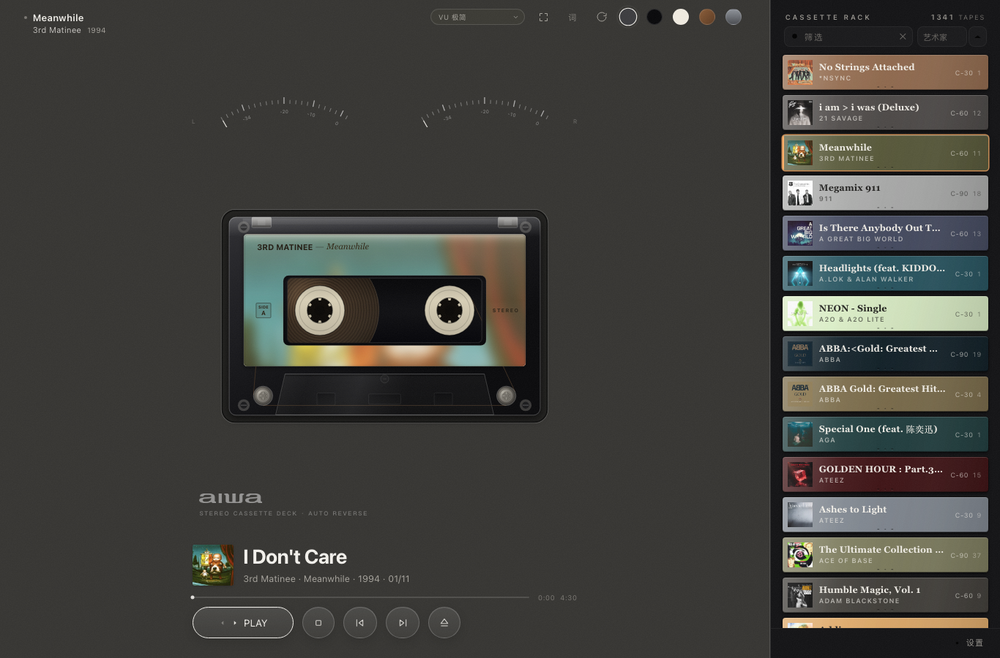

### 磁带卡座 · 直印皮肤
油墨直接印在半透明彩壳上，版面与贴纸完全同位，没有标签底。

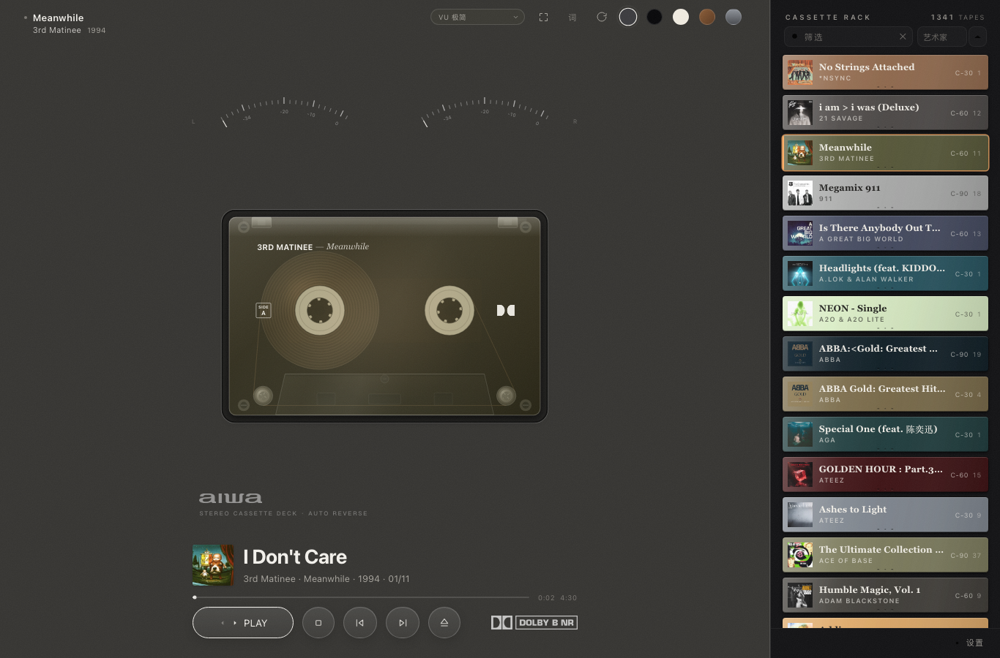

### 杜比标
被识别为杜比（Atmos / EAC-3 / AC-4 …）的专辑，会在标签右空档点亮镂空双 D——随底色自适应取墨色，中间不留白、没有底框。

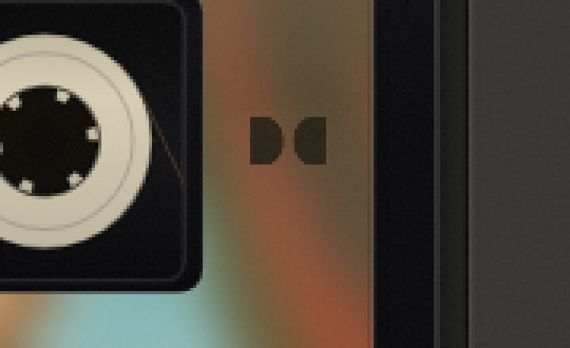

### 磁带架曲库
整个曲库就是一面磁带墙：封面缩略图、专辑、艺术家、按真实时长换算的 C-60/C-90 规格，支持筛选和按艺术家/标题排序。唱片机页有同款架子，摆的是黑胶封套。

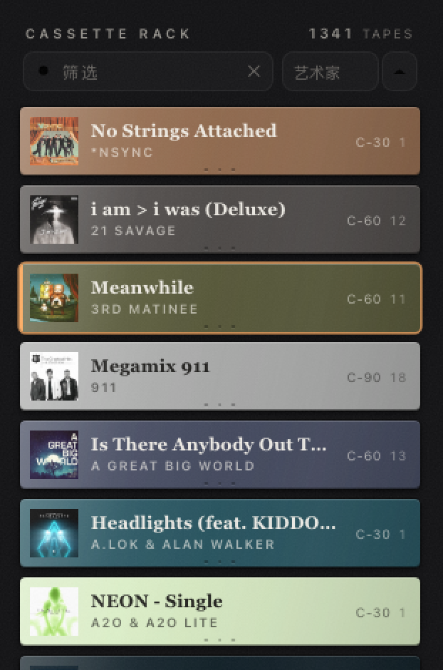

### 封套与书脊预览
出盒后封套立起来：前封面、取色封底、能真正读出来的书脊（自下而上，中英文同向侧躺）。

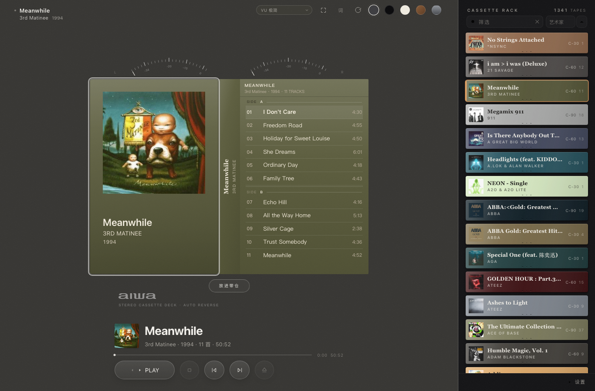

### 手机 / 平板适配
窄屏下面板会自动加高一点，aiwa 标和 "STEREO CASSETTE DECK · AUTO REVERSE" 信息行永远不会被裁掉。

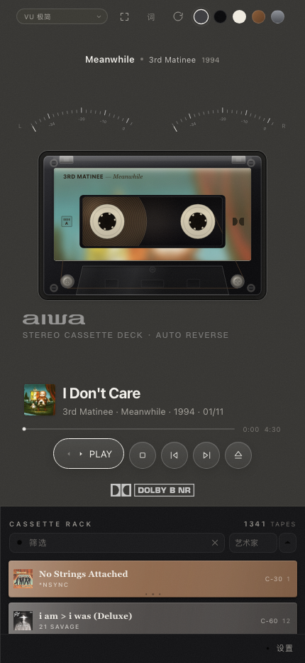

### 服务端频谱与智能音频
- 频谱在**服务端**计算（ffmpeg + numpy）再推流给页面——浏览器解不了的格式，表针照样跳。
- Safari 直接原生播 ALAC；其它浏览器按需转码（带缓存）。
- 逐曲识别杜比编码，可选 5.1 → 立体声下混。

### 为常驻而生
- **服务期间永不休眠** —— 常驻守卫挡住系统休眠，但没在播放时允许显示器正常熄屏。
- **只在播放时防熄屏**（任意客户端，30 秒心跳），停播即释放。
- 自检看门狗：服务不应答时自动原地重启；启动时清理上次遗留的守卫进程。
- 附带 launchd 配置：登录自启 + 挂掉自动拉起。

### 主题与表头
五种面板主题——石墨、纯黑、纸白、实木、拉丝金属——两页共用；表针样式可切换（频谱 / VU，各有极简变体），另有歌词开关。

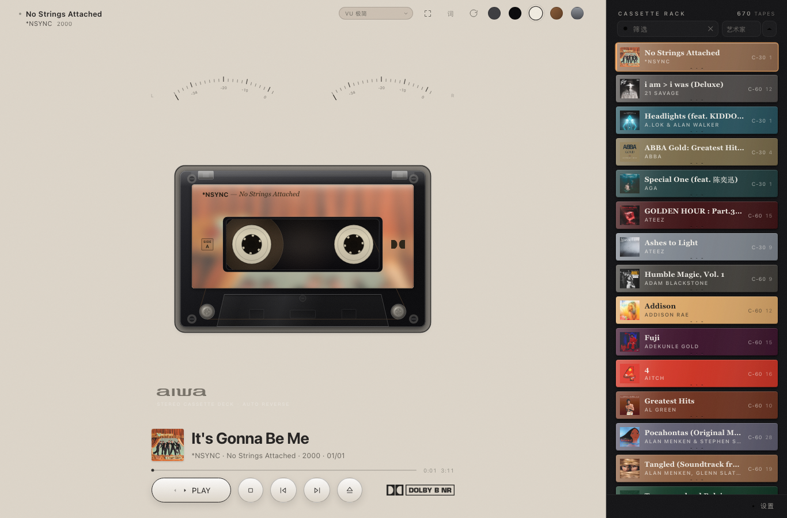

## 快速开始

环境要求：macOS 或 Linux，Python 3.9+，`numpy`（频谱用），PATH 里有 `ffmpeg`（转码 / 杜比 / 非原生格式频谱用）。防休眠守卫仅在 macOS 生效，其它平台自动跳过。

```bash
git clone https://github.com/aiventian-dev/warmplayer.git
cd warmplayer
python3 vinyl_server.py            # 监听 0.0.0.0:8900
```

打开：

- 唱片机：`http://localhost:8900/`
- 磁带机：`http://localhost:8900/tape`
- 其它设备：`http://<你的Mac内网IP>:8900/`

首次运行点架子底部的**设置**，添加音乐文件夹。曲库后台扫描，页面立即可用。

macOS 上也可以直接双击 `启动唱片机.command`。

### 配置

| 文件 | 用途 |
|---|---|
| `folders.json` | 音乐文件夹（由界面生成；参考 `folders.example.json`） |
| `settings.json` | 转码默认值、杜比模式、远程目录密码（参考 `settings.example.json`） |
| `cache/` | 标签、封面、取色、转码缓存——全部可再生，删了也不心疼 |

> **安全提示：** 服务端没有 TLS、没有账号体系，`folder_pwd` 只保护远程客户端进入「音乐目录」管理界面。请把它留在局域网 / VPN 内，或放在 HTTPS 反代后面；对外暴露前务必改掉默认密码。

### 常驻服务（macOS）

见 [`docs/launchd.md`](docs/launchd.md)：登录自启、挂掉自动拉起的 launchd 配置模板。

### 部署到群晖 / 任意 Docker 主机

见 [`docs/deploy-synology.md`](docs/deploy-synology.md)：容器把 python + ffmpeg + numpy 锁在一起，DSM 升级不影响、开机自启；音乐卷只读挂载，DSM 反代可套 HTTPS。音乐在 NAS 上时，这是比 Mac 更合适的家。

## 架构

```
vinyl_server.py     Python 标准库 HTTP 服务（ThreadingHTTPServer）
                    曲库扫描 · 标签 · 封面 · 封底取色
                    ffmpeg 转码缓存 · 服务端频谱推流
                    防休眠守卫 · 自检看门狗
唱片机.html          黑胶页 —— 单文件自包含（HTML+CSS+JS+资源全内联）
磁带机.html          磁带页 —— 同一基座，叠加卡座层
```

没有数据库，没有 node_modules。页面只和同源的 `/api/*` 接口说话。

## 想法清单

- 播放队列 / 歌单界面
- 更多卡座皮肤
- 可选的整站鉴权

## 许可证

[MIT](LICENSE)

## 致谢

献给那些永远不会磨损的实体介质。截图中的专辑封面版权归各自权利人所有，仅作演示。

## 作者与许可

WarmPlayer 由 **田瑞航（Ryan）** 创作与维护 — [github.com/aiventian-dev](https://github.com/aiventian-dev)。  
项目始于 2026 年。Copyright (c) 2026 田瑞航（Ryan），采用 [MIT 许可证](LICENSE)。
